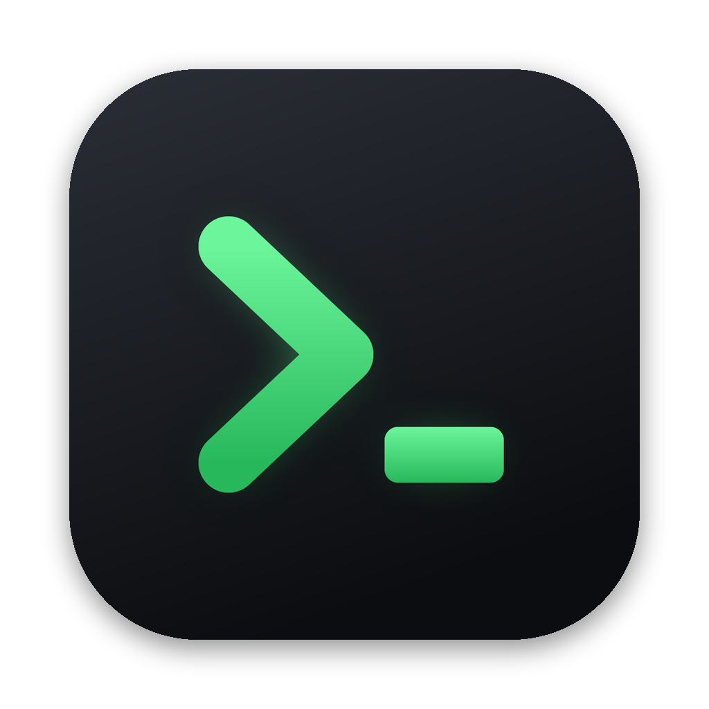

<p align="center"></p>

<h1 align="center">tterminal</h1>

<p align="center">An SSH terminal for Windows, macOS, Linux, iPhone and iPad.<br>GPU-rendered, friendly to input methods, and synced end-to-end encrypted through a server you run yourself.</p>

<p align="center"><a href="#中文">中文說明</a></p>

---

## What it does

- **Input methods that behave.** Composition happens right at the cursor and is only sent once you pick a candidate, so Zhuyin, Cangjie, Pinyin or Japanese never double-type or vanish halfway. CJK text and wide characters line up.
- **A real terminal engine.** Rust core built on `alacritty_terminal`, drawn by Flutter on the GPU. htop, vim, tmux and less work as they should.
- **SSH done properly.** Password or key auth, host fingerprints pinned on first connect (`russh`).
- **Desktop:** tabs, a file side pane that follows your shell (local and SFTP), a built-in editor with Markdown preview, drag and drop to Finder / Explorer.
- **Mobile:** an extra key row (esc, ctrl, tab, arrows, one-tap ^C / ^D), a long-press arrow joystick, sessions kept alive in the background with a Live Activity, two-pane layouts on iPad and iPhone Duo.
- **Vault + sync.** Hosts and keys live in a local vault and can sync across all your devices through [tterminal-sync](https://github.com/tterminal-app/tterminal-sync), a zero-knowledge server you host. Everything is encrypted on the device first.

## Download

| Platform | Get it |
|---|---|
| Windows (x64, arm64) | [Releases](https://github.com/tterminal-app/tterminal/releases) |
| macOS (universal: Apple silicon + Intel) | [Releases](https://github.com/tterminal-app/tterminal/releases) |
| Linux (x64, arm64) | [Releases](https://github.com/tterminal-app/tterminal/releases): AppImage, .deb, .rpm, .tar.gz |
| iPhone & iPad | App Store (free download, 14-day trial, one-time unlock) |
| Sync server | `docker run ghcr.io/tterminal-app/tterminal-sync` ([details](https://github.com/tterminal-app/tterminal-sync)) |

Desktop builds are free. The App Store version is how the project gets paid for; you're also welcome to build the iOS app yourself from this repo.

The macOS build isn't notarized yet: the first time, right-click the app and choose Open. On Windows, SmartScreen may warn about an unrecognized app until the builds are signed.

## Build from source

You need Rust (stable) and Flutter 3.47 or newer.

```sh
# Rust core: tests and the FFI library the app loads
cd core
cargo test
cargo build --release -p tterm-ffi

# Desktop app
cd ../app
flutter test
flutter build linux --release        # or: macos / windows
```

Per-platform scripts produce the same packages as the release builds:

| | |
|---|---|
| Windows | `scripts/build-windows.ps1` → single-file `tterminal.exe` |
| macOS | `scripts/build-macos.sh` → universal `tterminal.app` |
| iOS | `scripts/build-ios.sh` (sign it in Xcode with your own team) |

More detail, in Chinese: [docs/development.md](docs/development.md). The sync design is in [docs/vault-sync-design.md](docs/vault-sync-design.md) and the overall plan in [PLAN.md](PLAN.md).

## Repository layout

```
core/       Rust workspace: terminal engine, PTY / SSH sessions, vault crypto, C ABI for the app
app/        Flutter app, one UI for desktop and mobile
server/     tterm-server, the self-hosted sync server
packaging/  Windows single-file launcher
appstore/   App Store assets and the automated screenshot pipeline
oss/sync/   Files for the tterminal-sync repo (generated by scripts/export-sync-oss.sh)
```

## License

The app and the Rust core are [GPL-3.0](LICENSE). `server/` and `core/tterm-vault/` are [AGPL-3.0](server/LICENSE), the same as the [tterminal-sync](https://github.com/tterminal-app/tterminal-sync) repo.

## Contributing

Issues and pull requests are welcome. Pull requests need a one-time sign-off on the [Contributor License Agreement](CLA.md): it lets the project keep shipping on the App Store, which a GPL-only contribution would otherwise block. See [CONTRIBUTING.md](CONTRIBUTING.md).

Found a security problem? Please report it privately, see [SECURITY.md](SECURITY.md).

---

## 中文

Windows、macOS、Linux、iPhone 和 iPad 都能用的 SSH 終端機。畫面用 GPU 畫,中文輸入法不出包,主機和金鑰透過你自己架的伺服器端對端加密同步。

### 特色

- **輸入法好好打**:組字顯示在游標上,選好字才送出;注音、倉頡、拼音、日文都不會重複輸入或打到一半消失。中文和全形字都對得齊。
- **真正的終端引擎**:Rust 核心(基於 `alacritty_terminal`),Flutter 用 GPU 繪製,htop、vim、tmux、less 都照常跑。
- **SSH**:密碼或金鑰登入,第一次連線記下主機指紋,之後指紋變了會擋下來。
- **桌面版**:分頁、跟著 shell 走的檔案側窗(本機與 SFTP)、內建編輯器(Markdown 可預覽)、檔案可以拖進拖出。
- **手機版**:鍵盤上方的功能鍵列(esc、ctrl、tab、方向鍵,^C、^D 一鍵送出)、長按拖曳的方向鍵搖桿、背景保持連線並顯示在動態島、iPad 與 iPhone Duo 的兩欄版面。
- **Vault 與同步**:主機和金鑰存在本機 vault,可以透過自架的 [tterminal-sync](https://github.com/tterminal-app/tterminal-sync) 在所有裝置間同步,資料在裝置上就先加密。

### 下載

桌面版(Windows x64 / arm64、macOS universal、Linux x64 / arm64)在 [Releases](https://github.com/tterminal-app/tterminal/releases),免費。iPhone 和 iPad 版在 App Store:免費下載、14 天試用,喜歡再一次買斷。App Store 版是這個專案的收入來源,你也可以用這個 repo 自己編 iOS 版。

macOS 版還沒做公證,第一次開啟請在 app 上按右鍵選「打開」。Windows 版在簽章前,SmartScreen 可能會跳出警告。

### 自己編譯

需要 Rust(stable)和 Flutter 3.47 以上,步驟見上面的 [Build from source](#build-from-source),細節在 [docs/development.md](docs/development.md)。

### 授權

app 與 Rust 核心是 [GPL-3.0](LICENSE);`server/` 和 `core/tterm-vault/` 是 [AGPL-3.0](server/LICENSE)。

### 參與貢獻

歡迎開 issue 和 PR。PR 需要先同意一次[貢獻者授權協議(CLA)](CLA.md):這樣專案才能繼續在 App Store 上架,純 GPL 的貢獻會讓上架卡住。詳見 [CONTRIBUTING.md](CONTRIBUTING.md)。安全性問題請私下回報,見 [SECURITY.md](SECURITY.md)。
